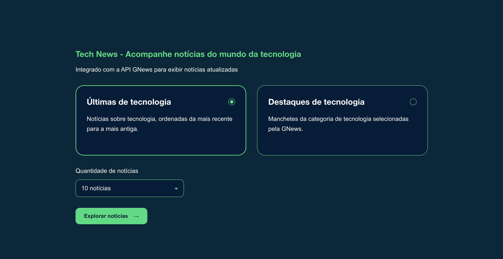

# Tech News — GNews + Ollama



Aplicação local para consultar notícias de tecnologia pela **GNews API** e gerar resumos em português com o modelo **Llama 3.1**, executado pelo **Ollama**.

A interface utiliza React, TypeScript e um carrossel manual com Swiper.js.

> O processamento pelo modelo acontece localmente. A consulta de notícias e o carregamento de imagens externas dependem de conexão com a internet.

## Funcionalidades

- Seleção entre duas modalidades:
  - **Últimas de tecnologia:** busca temática ordenada por data.
  - **Destaques de tecnologia:** manchetes da categoria de tecnologia.
- Escolha de 1, 5 ou 10 notícias.
- Resumos em português produzidos pelo `llama3.1`.
- Carrossel manual, sem reprodução automática.
- Exibição de fonte, data, palavras-chave e imagem, quando disponível.
- Placeholder para imagens ausentes ou com falha.
- Estados de carregamento e erro em uma tela dedicada.
- Cache temporário para reduzir consultas e processamento.

## Tecnologias

| Camada | Tecnologias |
|---|---|
| Interface | React e TypeScript |
| Desenvolvimento e build | Vite |
| Carrossel | Swiper.js |
| Backend local | Node.js e Express |
| Validação | Zod |
| Conversão de HTML para texto | html-to-text |
| Notícias | GNews API |
| Execução local do modelo | Ollama |
| Modelo de linguagem | Llama 3.1 |

## Arquitetura

```text
React + TypeScript
        │
        │ /api/news
        ▼
Backend local — Express
        ├── GNews API via HTTPS
        │   └── Notícias, fontes e imagens
        │
        └── Ollama local
            └── llama3.1 → resumo estruturado em português
```

A chave da GNews fica exclusivamente no backend. O navegador não consulta diretamente a API de notícias.

## Pré-requisitos

- Node.js 22 LTS ou outra versão suportada e compatível com o projeto.
- npm.
- [Ollama](https://ollama.com/) instalado.
- Modelo `llama3.1` disponível no Ollama.
- Conta e chave de API da [GNews](https://gnews.io/).
- Conexão com a internet para consultar notícias.

O desempenho da geração depende da memória e da capacidade de processamento da máquina.

## Instalação

### 1. Instale as dependências

Na pasta do projeto:

```bash
npm install
```

### 2. Baixe o modelo

```bash
ollama pull llama3.1
```

Confira os modelos instalados:

```bash
ollama list
```

Mantenha o Ollama em execução. Se necessário, inicie o serviço:

```bash
ollama serve
```

> Se o aplicativo Ollama já estiver executando o serviço, não é necessário iniciar uma segunda instância.

### 3. Configure as variáveis de ambiente

Crie o arquivo `.env` a partir do exemplo:

```bash
cp .env.example .env
```

Preencha:

```dotenv
PORT=3001
FRONTEND_ORIGIN=http://127.0.0.1:5173

OLLAMA_URL=http://127.0.0.1:11434
OLLAMA_MODEL=llama3.1

GNEWS_API_KEY=SUA_CHAVE_AQUI
GNEWS_LANG=pt
```

| Variável | Descrição |
|---|---|
| `PORT` | Porta do backend local. |
| `FRONTEND_ORIGIN` | Origem autorizada a acessar o backend pelo navegador. |
| `OLLAMA_URL` | Endereço do serviço Ollama. |
| `OLLAMA_MODEL` | Modelo utilizado para gerar os resumos. |
| `GNEWS_API_KEY` | Chave de autenticação da GNews. |
| `GNEWS_LANG` | Idioma das notícias: `pt` ou `en` nesta implementação. |

Mesmo quando as notícias são consultadas em inglês, a saída solicitada ao modelo é em português.

**Nunca versione o `.env` nem utilize o prefixo `VITE_` na chave da GNews.** Variáveis com esse prefixo podem ser expostas no frontend.

### 4. Execute o projeto

```bash
npm run dev
```

Acesse:

```text
http://127.0.0.1:5173
```

O backend utiliza, por padrão:

```text
http://127.0.0.1:3001
```

## Scripts

```bash
# Inicia frontend e backend em desenvolvimento
npm run dev

# Valida e gera o build do frontend
npm run build

# Visualiza o build do frontend
npm run preview
```

O comando `preview` não inicia o backend. Para utilizar a aplicação nesse modo, também é necessário configurar o acesso às rotas do backend; o proxy de desenvolvimento do Vite não faz parte do build.

## Como utilizar

1. Selecione **Últimas de tecnologia** ou **Destaques de tecnologia**.
2. Escolha a quantidade de notícias.
3. Clique em **Explorar notícias**.
4. Aguarde a consulta e o processamento local.
5. Navegue pelo carrossel usando setas, indicadores, teclado ou gesto de deslizar.
6. Utilize o link da publicação para conferir a fonte original.

O primeiro processamento pode demorar mais enquanto o Ollama carrega o modelo na memória.

## Integração com a GNews

**Base da API:**

```text
https://gnews.io/api/v4
```

**Documentação:** https://docs.gnews.io/

| Modalidade | Endpoint | Critério |
|---|---|---|
| Últimas de tecnologia | `/search` | Busca temática com `sortby=publishedAt`. |
| Destaques de tecnologia | `/top-headlines` | Categoria `technology`. |

A busca temática utiliza palavras relacionadas a tecnologia, inteligência artificial, software e hardware.

Essas modalidades empregam critérios diferentes. **Destaques não representam um ranking de “melhores notícias”.**

### Autenticação e limites

A GNews exige cadastro e chave de API. Cotas, atraso das notícias, quantidade de resultados e disponibilidade de conteúdo dependem do plano contratado.

- Uma chamada pode retornar várias notícias.
- O processamento pelo Ollama não consome requisições da GNews.
- Navegar entre os slides não gera novas consultas.
- Respostas obtidas do cache não geram uma nova consulta externa.

Confira os limites vigentes no painel e na documentação da GNews.

> Esta versão não implementa um contador persistente nem sincronização do consumo com o dashboard da GNews.

## Integração com o Ollama

O backend envia ao `llama3.1` somente o material disponibilizado pela GNews:

- Título.
- Descrição.
- Conteúdo, quando presente.

A resposta solicitada ao modelo contém:

- Título em português.
- Subtítulo.
- Até quatro palavras-chave.
- Primeiro parágrafo: contexto inicial.
- Segundo parágrafo: complemento.
- Terceiro parágrafo: ponto principal.

A data e a fonte são preenchidas pelo backend a partir dos dados da API, e não pelo modelo.

### Limitações dos resumos

A descrição e o conteúdo podem estar incompletos ou truncados. O sistema não baixa automaticamente a matéria original.

Quando não houver informação suficiente, o subtítulo ou os parágrafos podem permanecer vazios. O modelo é instruído a não inventar fatos nem repetir informações para preencher o formato.

A saída estruturada é validada, mas essa validação **não garante precisão factual**. Confira sempre a publicação original.

O Ollama deve estar atualizado e oferecer suporte a saídas estruturadas com JSON Schema.

## Cache e controle de tráfego

A aplicação utiliza:

| Recurso | Configuração |
|---|---|
| Notícias por seleção | Até 10 |
| Cache das consultas e listas finais | 5 minutos |
| Cache dos resumos | 30 minutos |
| Processamento | Uma geração em andamento por vez |
| Limite local de requisições | 30 por minuto |
| Proteções adicionais | Timeouts e validação de respostas |

O cache fica em memória e desaparece ao reiniciar o backend, inclusive nos reinícios automáticos durante o desenvolvimento.

O limite local de requisições não substitui nem representa a cota da GNews.

## Segurança e privacidade

### Credenciais

- A chave da GNews permanece no backend.
- O `.env` deve estar no `.gitignore`.
- URLs autenticadas, credenciais e corpos de erro externos não devem aparecer nos logs.
- Se uma chave for exposta, revogue-a e gere outra.

### Validação e XSS

Todos os dados externos, incluindo respostas do modelo, são considerados não confiáveis.

A aplicação:

- Valida os dados recebidos com Zod.
- Converte HTML das notícias em texto simples.
- Renderiza conteúdo textual pelo React.
- Não utiliza `dangerouslySetInnerHTML`.
- Aceita somente URLs HTTP e HTTPS sem credenciais embutidas.
- Abre links externos com `noopener noreferrer`.

### Conteúdo enviado ao modelo

As notícias podem conter instruções maliciosas, conhecidas como *prompt injection*.

O modelo é instruído a tratar esse material como dados e não recebe ferramentas, acesso a arquivos ou permissão para executar ações. Essas restrições reduzem o impacto de uma resposta indevida, mas não garantem que o modelo sempre seguirá as instruções.

### Imagens externas

As imagens são carregadas diretamente pelo navegador, quando disponíveis.

- Imagens ausentes ou com falha são substituídas pelo placeholder.
- O backend não baixa as imagens.
- A política `no-referrer` evita enviar o referenciador.
- O servidor da imagem ainda pode receber o IP do usuário e os dados normais da conexão.

### Serviços locais

Backend e Ollama devem permanecer restritos ao endereço de loopback, sem exposição à internet.

O processamento local do modelo não significa operação completamente offline: notícias e imagens continuam dependendo de serviços externos.

## Certificados em redes corporativas

Em ambientes com inspeção HTTPS, o Node.js pode apresentar:

```text
SELF_SIGNED_CERT_IN_CHAIN
```

Quando suportado pela versão instalada, utilize os certificados confiáveis do sistema:

```bash
NODE_USE_SYSTEM_CA=1 npm run dev
```

Essa configuração também pode estar incorporada ao script do backend.

Para testar o suporte:

```bash
node --help | grep use-system-ca
```

Se necessário, solicite ao TI a CA corporativa aprovada e configure `NODE_EXTRA_CA_CERTS` antes de iniciar o processo Node.

**Não desabilite a validação TLS com `NODE_TLS_REJECT_UNAUTHORIZED=0`.**

## Solução de problemas

### A GNews recusou a autenticação

Confira `GNEWS_API_KEY` no `.env` e reinicie o backend após alterar o arquivo.

### A GNews negou acesso ou atingiu o limite

Verifique a validade da chave, a cota e as permissões do plano no dashboard da GNews. Evite reiniciar o backend desnecessariamente, pois isso limpa o cache.

### O resumo não foi gerado

Verifique:

```bash
ollama list
```

Confirme que o serviço está ativo e que `llama3.1` está instalado. A geração também pode falhar por timeout ou falta de recursos na máquina.

### A notícia não possui três parágrafos

O conteúdo fornecido pela API pode ser insuficiente. A aplicação permite campos vazios para evitar preenchimento sem fundamento.

### A imagem não aparece

A URL pode estar indisponível ou o servidor de origem pode bloquear o carregamento. Nesse caso, a aplicação mantém o placeholder.

## Estrutura principal

```text
.
├── docs/
│   └── gnews-api.md
├── server/
│   └── index.ts
├── src/
│   ├── App.tsx
│   ├── main.tsx
│   └── styles.css
├── .env.example
├── .gitignore
├── package.json
└── vite.config.ts
```

## Termos e direitos de uso

A contratação ou gratuidade da API não elimina os direitos dos veículos, autores e responsáveis pelas imagens.

Antes de distribuir ou utilizar o projeto comercialmente, verifique:

- Os termos vigentes e as permissões do plano da GNews.
- Os direitos de exibição e reprodução dos conteúdos.
- As condições aplicáveis ao processamento por IA.
- A licença e os termos do modelo Llama 3.1.
- As licenças das dependências utilizadas.

Os resumos gerados por IA são auxiliares e não substituem a leitura da fonte original.